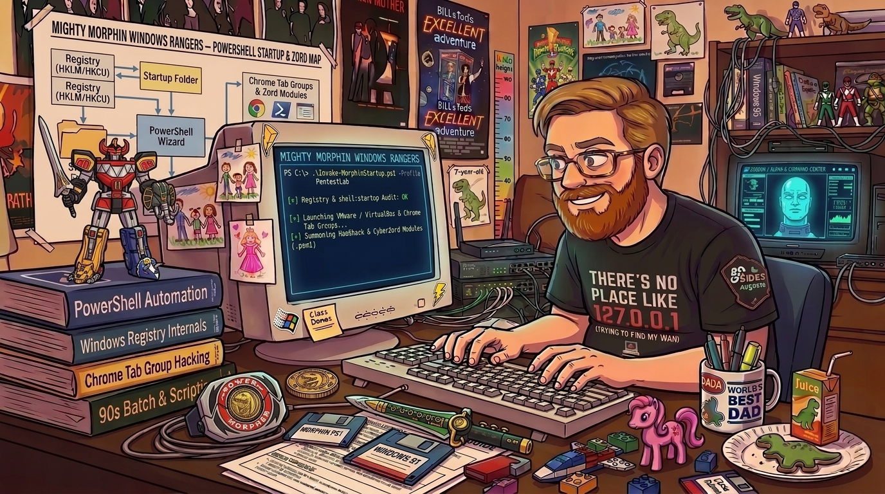
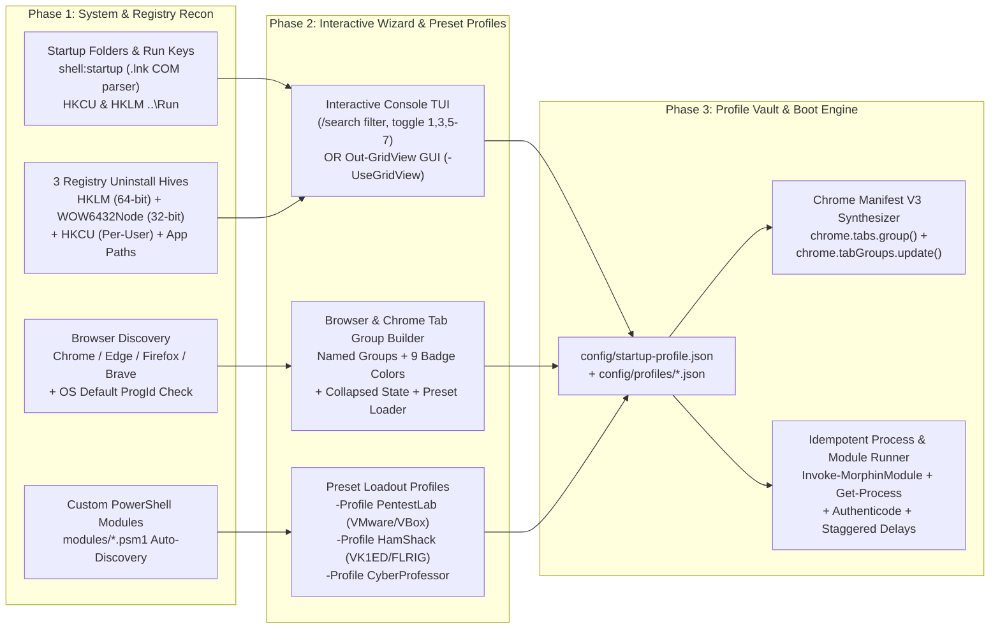

# `mighty-morphin-windows-rangers` // Pure PowerShell Startup, Chrome Tab Groups & Custom Zord Module Deck

```text
+----------------------------------------------------------------------------------------------+
| [/] MIGHTY MORPHIN WINDOWS RANGERS // Invoke-MorphinStartup.ps1                [_][#][X]     |
+----------------------------------------------------------------------------------------------+
|                                                                                              |
|     .-------------.                        .-------------------.              .-----------.  |
|     | .---------. |   HKLM\..\Uninstall    | [1] shell:startup |   --tabs     | [o] [o]   |  |
|     | | PS C:\> | |  ===================>  | [2] Registry Apps |  =========>  |  CHROME   |  |
|     | | MORPHIN | |    shell:startup       | [3] Main Browser  |   TabGroups  |  TAB GRPS |  |
|     | |  TIME!  | |  ===================>  | [4] Zord Modules  |  =========>  |  .PSM1    |  |
|     | '---------' |   modules\*.psm1       '-------------------'              '-----------'  |
|     '-----+-+-----'                                  |                                       |
|       .---'-'---.          "THERE'S NO PLACE LIKE 127.0.0.1 (TRYING TO FIND MY WAN)"         |
|      /:::::::::::\         "Ay-yi-yi-yi-yi! Hold your dino cookies—Dad is morphin boot!"     |
|                                                                                              |
+==============================================================================================+
|  [ SYSOP: Dr. Cory Singleton (d4rksp2rk) // ENGINE: 100% Pure PowerShell 5.1+ & 7+        ]  |
|  [ PROFILES: Custom Wizard | -Profile PentestLab | -Profile HamShack | -Profile CyberProf ]  |
+==============================================================================================+
```

[](Invoke-MorphinStartup.ps1)
[](docs/REGISTRY_AND_CHROME_TRADECRAFT.md)
[](Invoke-MorphinStartup.ps1)
[](config/profiles/)

<p align="center">
  
</p>

> *"Back in 1995, while Zordon and Alpha-5 were summoning the Dinozords in the Command Center, a true keyboard cowboy didn't click fifteen desktop icons after booting his Windows 95 rig. Today, between spinning up VMware & VirtualBox pentest labs, firing up `FLRIG` and `WSJT-X` in the ham shack, grading network forensics packet captures, and keeping a 7-year-old supplied with dino cookies, nobody has time to manually launch twenty apps and thirty browser tabs every morning. Drop into **100% pure PowerShell**, query the Registry hives, group your Chrome tabs by Ranger color, snap in your own `.psm1` Zord modules, and shout: **IT'S MORPHIN TIME!**"*

---

## `0x00` // What Is `mighty-morphin-windows-rangers`?

**`mighty-morphin-windows-rangers`** ([`Invoke-MorphinStartup.ps1`](Invoke-MorphinStartup.ps1)) is a **100% pure-PowerShell** (zero batch files!) interactive Windows startup orchestrator built with a **Nerdy Cyber Professor / 90s Hacker Dad** soul.

Instead of hardcoding static file paths, [`Invoke-MorphinStartup.ps1`](Invoke-MorphinStartup.ps1) **interrogates your live system first** and walks you through an interactive Command Center Setup Wizard—or lets you boot directly into battle-tested **Ranger Loadout Profiles** (`-Profile PentestLab`, `-Profile HamShack`, `-Profile CyberProfessor`):

1. **Forensic Startup Folder & Registry `Run` Inspection (`shell:startup`):**
   * Audits your Per-User Startup folder (`%APPDATA%\...\Startup`), All-Users Common Startup folder (`%ProgramData%\...\StartUp`), and Registry `Run` keys (`HKCU` & `HKLM`).
   * Uses `WScript.Shell` COM automation to unwrap `.lnk` shortcuts and show you the **true target executable and CLI flags** already launching on your machine.
2. **3-Hive Windows Registry Installed Application Scanner:**
   * Queries **64-bit (`HKLM`)**, **32-bit (`HKLM\WOW6432Node`)**, and **Per-User (`HKCU`)** `Uninstall` Registry hives—plus `App Paths`—in milliseconds *(without ever touching the dreaded, slow `Win32_Product` WMI class!)*.
   * Automatically resolves the primary `.exe` binary for each installed program so you can pick what you want to launch from an interactive **Console TUI** (with live `/search` filtering) or a graphical **`Out-GridView` multi-select window** (`-UseGridView`).
3. **Main Browser & Native Chrome Tab Group Orchestrator:**
   * Auto-detects your installed browsers (**Google Chrome**, **Microsoft Edge**, **Mozilla Firefox**, **Brave**, **Vivaldi**) and highlights your current OS default browser (`HKCU\...\UrlAssociations\http\UserChoice`).
   * **Special Chrome Ranger Power-Up:** If you choose **Google Chrome**, the wizard lets you organize your startup URLs into:
     * **`[1]` Native Color-Coded & Named Chrome Tab Groups** (e.g., `[RED]` *SOC & Threat Intel*, `[BLUE]` *Professor Command Deck*, `[GREEN]` *90s Hacker Dad Shack*—using an auto-synthesized, zero-dependency Manifest V3 `chrome.tabGroups` micro-extension!),
     * **`[2]` Separate Chrome Windows per Topic Group** (`--new-window`), or
     * **`[3]` Standard Tabs in a Single Window**.
4. **Built-In Specialty Startup Loadout Profiles (`-Profile`):**
   * **`-Profile PentestLab`:** Launches **VMware Workstation (`vmrun.exe`)** and/or **Oracle VirtualBox (`VBoxManage.exe`)** offensive/forensics VMs (`Kali-Rolling`, `REMnux`, `Metasploitable3`), **Wireshark**, **Windows Terminal**, **VS Code**, **SO-CRATES**, and Red Team / CTI Chrome Tab Groups.
   * **`-Profile HamShack`:** Modeled after **[VK Ham Radio's "The Ultimate Budget Ham Shack – Overview and Concept"](https://www.vkhamradio.com/the-ultimate-budget-ham-shack-overview-and-concept/)** and **`csra-ham-dmr-automation`** (`DE KR4JLC`): probes USB CAT / K-Plug COM ports, initializes **`FLRIG`** (CAT master linchpin) first, then launches **`WSJT-X`**, **`GridTracker`**, **`Ham2K Portable Logger`**, and **`CHIRP-next`**, plus Shack WallBoard / Propagation / POTA / CSRA Repeater Chrome Tab Groups!
   * **`-Profile CyberProfessor`:** Launches **VS Code**, **Obsidian**, **Docker (`SO-CRATES`)**, **Discord**, and Academic / CLARK / NICE / Google Scholar Chrome Tab Groups.
5. **Pluggable Custom PowerShell Zord Modules ([`modules/*.psm1`](modules/)):**
   * Drop any custom PowerShell module (`.psm1`) into [`modules/`](modules/)—or generate a new one in 1 second with `.\Invoke-MorphinStartup.ps1 -Mode NewModule -ModuleName "Morphin.MyZord"`—and the wizard automatically discovers it, prompts you for custom settings, and executes it at startup!

---

## `0x01` // Architecture of the Megazord Startup Pipeline



---

## `0x02` // Quickstart: Summoning Your Battle Station (100% Pure PowerShell)

Open **PowerShell** (`Windows PowerShell 5.1` or `PowerShell 7+ / pwsh`) and run:

```powershell
# Clone the repository
git clone https://github.com/popeye1919/mighty-morphin-windows-rangers.git
cd mighty-morphin-windows-rangers

# Allow running local PowerShell scripts in the current session
Set-ExecutionPolicy -Scope Process -ExecutionPolicy Bypass

# 1. Launch the Interactive Command Center Main Menu (Pick Wizard, Profiles, Audit, or Module Creator)
.\Invoke-MorphinStartup.ps1

# 2. Or jump straight into the Interactive Setup Wizard (Console TUI with live /search filtering)
.\Invoke-MorphinStartup.ps1 -Mode Wizard

# 3. Prefer a clickable Windows GUI table for picking installed Registry programs?
.\Invoke-MorphinStartup.ps1 -Mode Wizard -UseGridView

# 4. Boot straight into one of the Built-In Specialty Ranger Loadout Profiles!
.\Invoke-MorphinStartup.ps1 -Profile PentestLab       # VMware/VirtualBox VMs + Wireshark + Red Team Tab Groups
.\Invoke-MorphinStartup.ps1 -Profile HamShack         # VK1ED Budget Ham Shack: FLRIG -> WSJT-X -> GridTracker -> Ham2K
.\Invoke-MorphinStartup.ps1 -Profile CyberProfessor   # VS Code + Obsidian + Docker SO-CRATES + CLARK/Scholar Tab Groups

# 5. Execute your personal saved startup profile (config\startup-profile.json)
.\Invoke-MorphinStartup.ps1 -Mode Run

# 6. Scaffold your own custom PowerShell module (.psm1) in .\modules\
.\Invoke-MorphinStartup.ps1 -Mode NewModule -ModuleName "Morphin.MyCustomZord"

# 7. Register Invoke-MorphinStartup.ps1 into Windows shell:startup (backs up existing shortcuts first!)
.\Invoke-MorphinStartup.ps1 -Mode Install
```

---

## `0x03` // Built-In Specialty Startup Loadout Profiles (`config/profiles/`)

In addition to building your own personal `config/startup-profile.json` through the Interactive Wizard, you can summon three specialized **90s Hacker Dad Loadout Profiles** right from the CLI (`-Profile <Name>`) or the Command Center Menu (`Options [4]`, `[5]`, and `[6]`).

Click any loadout below to inspect its automated application stack, custom `.psm1` Zord modules, and color-coded Chrome Tab Groups:

<details open>
<summary><b>🐉 1. <code>-Profile PentestLab</code> — Green Dragonzord Offensive & Forensics Lab (VMware / VirtualBox)</b></summary>
<br>

* **Profile Config File:** [`config/profiles/profile-pentest-lab.json`](config/profiles/profile-pentest-lab.json)
* **Hypervisor Zord Module:** [`modules/Morphin.PentestVMs.psm1`](modules/Morphin.PentestVMs.psm1)
  * Automatically locates **VMware Workstation (`vmrun.exe`)** and **Oracle VirtualBox (`VBoxManage.exe`)**.
  * Checks `VBoxManage list runningvms` so it never double-boots an active VM, then starts your configured lab VMs (`Kali-Rolling`, `REMnux-Forensics`, `Metasploitable3-AD`) in GUI or Headless (`--type headless` / `nogui`) mode!
* **WSL2 & Container Zord Module:** [`modules/Morphin.CyberLab.psm1`](modules/Morphin.CyberLab.psm1)
  * Warms up `wsl.exe -d kali-linux` and starts the `so-crates-lab` Network Forensics container.
* **Desktop Applications Launched:**
  * `VMware Workstation Pro` (`vmware.exe`) / `Oracle VirtualBox Manager` (`VirtualBox.exe`)
  * `Wireshark` (`Wireshark.exe`)
  * `Windows Terminal` (`wt.exe`)
  * `Visual Studio Code` (`Code.exe`)
* **Native Chrome Tab Groups:**
  * **`[RED]` Red Team & Exploit Tradecraft:** [GCHQ CyberChef](https://gchq.github.io/CyberChef/), [MITRE ATT&CK](https://attack.mitre.org/), [GTFOBins](https://gtfobins.github.io/), [LOLBAS](https://lolbas-project.github.io/), [Exploit-DB](https://www.exploit-db.com/)
  * **`[PURPLE]` Network Forensics & CTI:** `http://127.0.0.1:8000` (Local SO-CRATES), [SO-CRATES Docs](https://so-crates.org/), [VirusTotal](https://www.virustotal.com/gui/home/search), [Shodan](https://www.shodan.io/)
  * **`[CYAN]` CTF Ranges & Course Labs *(Collapsed)*:** [`Penetration_Testing_Course`](https://github.com/popeye1919/Penetration_Testing_Course), [`Network_Forensics_Course`](https://github.com/popeye1919/Network_Forensics_Course), [TryHackMe](https://tryhackme.com/), [HackTheBox](https://app.hackthebox.com/)
</details>

<details>
<summary><b>📻 2. <code>-Profile HamShack</code> — Yellow Sabertooth Ultimate Budget Ham Shack (VK1ED Concept + CSRA <code>KR4JLC</code>)</b></summary>
<br>

* **Profile Config File:** [`config/profiles/profile-ham-shack.json`](config/profiles/profile-ham-shack.json)
* **Architectural Inspiration:** Modeled directly after **[Bob (VK1ED)'s "The Ultimate Budget Ham Shack – Overview and Concept" (`vkhamradio.com`)](https://www.vkhamradio.com/the-ultimate-budget-ham-shack-overview-and-concept/)** paired with our **[`csra-ham-dmr-automation`](https://github.com/popeye1919/csra-ham-dmr-automation)** project (`DE KR4JLC`).
* **Why Launch Order Matters in a Digital Ham Shack ([`modules/Morphin.HamShack.psm1`](modules/Morphin.HamShack.psm1)):**
  In VK1ED's *Ultimate Budget Ham Shack* architecture, **`FLRIG`** acts as the central CAT control multiplexer connected to your transceiver over USB serial. If `WSJT-X` or `Ham2K Logger` launches *before* `FLRIG` has seized the COM port and initialized CAT polling, they throw rig connection errors. Our `HamShack` profile enforces a strict, staggered dependency chain:
  1. **COM Port Probe (`Morphin.HamShack.psm1`):** Scans Windows `Win32_PnPEntity` for connected USB CAT transceivers and K-Plug programming cables (`FTDI`, `WCH CH340`, `Silicon Labs CP210x`, `BTECH GD32`) and prints the current **UTC Shack WallBoard Clock**.
  2. **Step 1 (`t + 0s`): `FLRIG` (`flrig.exe`)** — Launches first with a **4-second CAT stabilization delay** so transceiver frequency, band tracking, and PTT control are online.
  3. **Step 2 (`t + 4s`): `WSJT-X` (`wsjtx.exe`)** — Hooks cleanly into `FLRIG` for FT8 / FT4 / JS8Call weak-signal operation.
  4. **Step 3 (`t + 7s`): `GridTracker` (`GridTracker.exe`)** — Attaches to `WSJT-X`'s UDP multicast stream for live grid-square mapping and callsign alerting.
  5. **Step 4 (`t + 9s`): `Ham2K Portable Logger` (`Ham2K PoLo.exe`)** — Multi-platform QSO logger for POTA, SOTA, WWFF, LoTW, and QRZ.com.
  6. **Step 5 (`t + 11s`): `CHIRP-next` (`chirpw.exe`)** — Ready for VHF/UHF HT and mobile repeater codeplug management.
* **Native Chrome Tab Groups (The "WallBoardPC" & Operating Desk):**
  * **`[YELLOW]` Shack WallBoard & Propagation:** [VK Ham Radio Ultimate Budget Ham Shack Guide](https://www.vkhamradio.com/the-ultimate-budget-ham-shack-overview-and-concept/), [PSKReporter Live Map](https://pskreporter.info/pskmap.html), [DXHeat Cluster](https://dxheat.com/dxc/), [HF Solar Propagation (`hamqsl.com`)](https://www.hamqsl.com/solar.html), [Time.is UTC Clock](https://time.is/UTC)
  * **`[ORANGE]` POTA / SOTA / QRZ & Logging:** [POTA Spots (`pota.app`)](https://pota.app/), [QRZ.com](https://www.qrz.com/), [ARRL LoTW](https://lotw.arrl.org/), [Ham2K PoLo Docs](https://polologger.com/)
  * **`[GREEN]` CSRA W4DV & DMR Repeaters *(Collapsed)*:** [`csra-ham-dmr-automation`](https://github.com/popeye1919/csra-ham-dmr-automation), [W4DV Area Repeaters](https://w4dv.club/repeaters/area-repeaters/), [TGIF DMR Network](https://tgif.network/), [Official CHIRP Wiki](https://chirpmyradio.com/projects/chirp/wiki/Home)
</details>

<details>
<summary><b>🎓 3. <code>-Profile CyberProfessor</code> — Blue Triceratops Academic, Grading & Research Deck</b></summary>
<br>

* **Profile Config File:** [`config/profiles/profile-cyber-professor.json`](config/profiles/profile-cyber-professor.json)
* **Zord Modules Enabled:** [`Morphin.Alpha5Greeting.psm1`](modules/Morphin.Alpha5Greeting.psm1) + [`Morphin.CyberLab.psm1`](modules/Morphin.CyberLab.psm1)
* **Desktop Applications Launched:** `Visual Studio Code`, `Obsidian` (Knowledge Graph & Lecture Notes), `Docker Desktop` (`SO-CRATES`), and `Discord` (minimized).
* **Native Chrome Tab Groups:**
  * **`[BLUE]` Course Syllabi & GitHub Labs:** [`Network_Forensics_Course`](https://github.com/popeye1919/Network_Forensics_Course), [`Penetration_Testing_Course`](https://github.com/popeye1919/Penetration_Testing_Course), [`mighty-morphin-windows-rangers`](https://github.com/popeye1919/mighty-morphin-windows-rangers)
  * **`[CYAN]` CLARK / NICE / DCWF Standards:** [CLARK.Center](https://clark.center/), [Google Scholar](https://scholar.google.com/), [MITRE ATT&CK](https://attack.mitre.org/)
</details>

---

## `0x04` // Inside the Interactive Command Center Wizard (`-Mode Wizard`)

Click any phase below to see how [`Invoke-MorphinStartup.ps1`](Invoke-MorphinStartup.ps1) interrogates your system when you build your own custom profile:

<details>
<summary><b>⚡ Phase 1 & Phase 2: Inspecting <code>shell:startup</code> + Selecting Installed Registry Programs</b></summary>
<br>

First, the wizard unwraps every `.lnk` shortcut in `shell:startup`, `shell:common startup`, and `HKCU`/`HKLM` `Run` keys. Next, it scans all three Registry `Uninstall` hives (`HKLM`, `HKLM\WOW6432Node`, and `HKCU`) plus `App Paths` and presents an interactive, searchable Console TUI (or `Out-GridView` window with `-UseGridView`):

```text
 [0x02] // PHASE 2: INSTALLED PROGRAMS VIA WINDOWS REGISTRY QUERY
        Scanned HKLM (64-bit), HKLM\WOW6432Node (32-bit), HKCU Uninstall & App Paths
==============================================================================================
    [#]    Status     ID         Application Name                 Publisher                Resolved Executable
    ----------------------------------------------------------------------------------------------------------------
    [ 1]   [SELECTED] REG-01     Visual Studio Code               Microsoft Corporation    ...\Microsoft VS Code\Code.exe
    [ 2]   [SELECTED] REG-02     Wireshark 4.4.2 (64-bit)         The Wireshark develop... C:\Program Files\Wireshark\Wireshark.exe
    [ 3]   [        ] REG-03     Obsidian                         Obsidian                 ...\Programs\Obsidian\Obsidian.exe
    [ 4]   [        ] REG-04     Windows Terminal                 Microsoft Corporation    ...\Microsoft\WindowsApps\wt.exe
    [ 5]   [SELECTED] REG-05     CHIRP-next (Ham Radio CPS)       Dan Smith (KK7DS)        C:\Program Files (x86)\CHIRP\chirpw.exe

    Commands: Enter number(s) to toggle (e.g. 1,3,5-7) | /search <name> | /all (reset filter) | /custom | done
```
* **Instant Filtering:** Have 200+ installed programs? Type `/search wireshark` or `/search vmware` to filter the table immediately, toggle apps by number, configure per-app CLI arguments, launch delays, and window styles (`Normal`, `Minimized`, `Maximized`), then type `/all` or `done`.
</details>

<details>
<summary><b>🌐 Phase 3: Main Browser Detection & Native Color-Coded Chrome Tab Groups</b></summary>
<br>

The wizard detects your installed browsers and asks if you want startup websites opened. If you select **Google Chrome**, it unlocks **Native Chrome Tab Group Orchestration**:

```text
    +----------------------------------------------------------------------------------+
    | [CHROME RANGER DETECTED] — Choose Your Tab & Tab Group Strategy:                 |
    |   [1] Native Colored Chrome Tab Groups (Named & color-coded inside 1 window!)    |
    |   [2] Separate Chrome Windows per Group (Each group opens in its own window)     |
    |   [3] Standard Tabs in a Single Window (All websites open as regular tabs)       |
    +----------------------------------------------------------------------------------+
```

Define your own custom Tab Groups using all **9 official Chrome Tab Group badge colors** (`blue`, `red`, `yellow`, `green`, `pink`, `purple`, `cyan`, `orange`, `grey`) and whether each group starts **expanded or collapsed**—or type **`preset`** at the prompt to load the starter tab groups automatically!
</details>

<details>
<summary><b>🤖 Phase 4: Bundled Custom PowerShell Zord Modules (<code>modules/*.psm1</code>)</b></summary>
<br>

Out of the box, [`modules/`](modules/) ships with **5 toggleable PowerShell Zord Modules** that you can enable or customize during Phase 4 of the wizard:

| Module File | Ranger / Zord | What It Automates at Startup |
| :--- | :--- | :--- |
| **[`Morphin.Alpha5Greeting.psm1`](modules/Morphin.Alpha5Greeting.psm1)** | **Red Ranger / Alpha-5** | Displays a morning workstation telemetry HUD (host, OS build, logical CPU threads) and optionally speaks an Alpha-5 greeting (`"Ay-yi-yi-yi-yi!"`) via `System.Speech.Synthesis.SpeechSynthesizer`. |
| **[`Morphin.NetCheck.psm1`](modules/Morphin.NetCheck.psm1)** | **Blue Ranger / Triceratops** | Verifies WAN ICMP reachability (`1.1.1.1`), tests DNS resolution (`github.com`), and enumerates active VPN tunnel interfaces (`WireGuard`, `OpenVPN`, `Tailscale`, `Cisco AnyConnect`). |
| **[`Morphin.CyberLab.psm1`](modules/Morphin.CyberLab.psm1)** | **Black Ranger / Mastodon** | Warms up your favorite WSL2 Linux distribution in the background (`wsl.exe -d kali-linux`) and auto-starts your forensic Docker containers (`docker start so-crates-lab`). |
| **[`Morphin.PentestVMs.psm1`](modules/Morphin.PentestVMs.psm1)** | **Green Ranger / Dragonzord** | Auto-detects **VMware Workstation (`vmrun.exe`)** and **Oracle VirtualBox (`VBoxManage.exe`)** and boots your target pentest/forensics VMs (`Kali-Rolling`, `REMnux`, `Metasploitable3`) in GUI or Headless mode. |
| **[`Morphin.HamShack.psm1`](modules/Morphin.HamShack.psm1)** | **Yellow Ranger / Sabertooth** | Inspired by [VK1ED's Ultimate Budget Ham Shack](https://www.vkhamradio.com/the-ultimate-budget-ham-shack-overview-and-concept/): probes Windows WMI/CIM for USB CAT & K-Plug COM ports, displays the UTC Shack Clock, and coordinates CAT startup delays for `FLRIG` $\rightarrow$ `WSJT-X` $\rightarrow$ `GridTracker` $\rightarrow$ `Ham2K`. |
</details>

---

## `0x05` // Build Your Own Custom PowerShell Module (`.psm1` Zord Developer Guide)

Want to make this startup script uniquely yours—whether that means mounting encrypted network drives, running `git pull` across your repositories, setting a custom power plan, querying ham radio solar propagation data, or spinning up Hyper-V VMs?

**You don't even have to edit [`Invoke-MorphinStartup.ps1`](Invoke-MorphinStartup.ps1)!** Any `.psm1` PowerShell module dropped into the **[`modules/`](modules/)** folder is automatically discovered, added to the Interactive Wizard, and executed at boot.

Click the expandable guides below to build and plug in your own custom PowerShell module in under 2 minutes:

<details>
<summary><b>🛠️ Step 1: Auto-Generate a New Module Template in 1 Command (<code>-Mode NewModule</code>)</b></summary>
<br>

Run [`Invoke-MorphinStartup.ps1`](Invoke-MorphinStartup.ps1) with `-Mode NewModule` and pass your desired module name:

```powershell
.\Invoke-MorphinStartup.ps1 -Mode NewModule -ModuleName "Morphin.GitSync"
```

This automatically generates **[`modules/Morphin.GitSync.psm1`](modules/)** pre-wired with the 3-function Zord contract and `Export-ModuleMember`. Verify that the Command Center sees your new module by running:

```powershell
.\Invoke-MorphinStartup.ps1 -Mode ListModules
```
</details>

<details>
<summary><b>📐 Step 2: Understand the 3-Function PowerShell Module Contract</b></summary>
<br>

Every `.psm1` file inside [`modules/`](modules/) exports up to three standard PowerShell functions:

1. **`Get-MorphinModuleInfo` *(Required)*:**
   Returns metadata so the Interactive Wizard can display your module's name, Ranger color, author, and description in the Phase 4 table:
   ```powershell
   function Get-MorphinModuleInfo {
       return [PSCustomObject]@{
           ModuleName  = "Morphin.GitSync"
           ZordName    = "White Tigerzord Git Repository Syncer"
           RangerColor = "White"
           Version     = "1.0.0"
           Author      = "Tommy Oliver (d4rksp2rk)"
           Description = "Automatically runs 'git pull' on your favorite local repositories at login."
       }
   }
   ```

2. **`Set-MorphinModuleConfig` *(Optional — Interactive Wizard Hook)*:**
   If your module exports `Set-MorphinModuleConfig`, [`Invoke-MorphinStartup.ps1`](Invoke-MorphinStartup.ps1) automatically calls it during **`-Mode Wizard`** whenever the user selects your module! Ask the user any questions you want via `Read-Host` and return an `[Ordered]@{ ... }` hashtable—the orchestrator automatically saves their answers inside `config/startup-profile.json`:
   ```powershell
   function Set-MorphinModuleConfig {
       param([hashtable]$CurrentSettings = @{})

       $defaultPath = if ($CurrentSettings.RepoFolder) { $CurrentSettings.RepoFolder } else { "$HOME\Desktop\Repos" }
       Write-Host -NoNewline "    [?] Enter folder containing your Git repos [$defaultPath]: " -ForegroundColor Yellow
       $folder = Read-Host
       if ([string]::IsNullOrWhiteSpace($folder)) { $folder = $defaultPath }

       return [Ordered]@{
           RepoFolder = $folder.Trim()
       }
   }
   ```

3. **`Invoke-MorphinModule` *(Required — Startup Execution Engine)*:**
   Called automatically during **`-Mode Run`**. It receives the user's saved `$Settings` hashtable from `config/startup-profile.json` and a `[switch]$DryRun` flag for safe testing:
   ```powershell
   function Invoke-MorphinModule {
       [CmdletBinding()]
       param(
           [Parameter()][hashtable]$Settings = @{},
           [Parameter()][switch]$DryRun
       )

       $targetDir = $Settings.RepoFolder
       Write-Host "    [TIGERZORD GIT SYNC] Checking repositories in: $targetDir" -ForegroundColor Cyan

       if ($DryRun) {
           Write-Host "    [+] [DRY-RUN] Would run 'git pull' inside $targetDir" -ForegroundColor Green
           return
       }

       if ($targetDir -and (Test-Path $targetDir)) {
           Get-ChildItem -Path $targetDir -Directory | ForEach-Object {
               if (Test-Path (Join-Path $_.FullName ".git")) {
                   Write-Host "    [*] Pulling latest commits for $($_.Name)..." -ForegroundColor Cyan
                   git -C $_.FullName pull --ff-only
               }
           }
       }
   }

   Export-ModuleMember -Function Get-MorphinModuleInfo, Set-MorphinModuleConfig, Invoke-MorphinModule
   ```
</details>

<details>
<summary><b>🚀 Step 3: Enable, Test-Drive (<code>-DryRun</code>), and Persist Your Custom Module</b></summary>
<br>

Once you save your `.psm1` file inside [`modules/`](modules/):

1. **Enable & Configure It in the Wizard:**
   ```powershell
   .\Invoke-MorphinStartup.ps1 -Mode Wizard
   ```
   When you reach **Phase 4 (`SUMMON CUSTOM POWERSHELL ZORD MODULES`)**, select your module's number. Your `Set-MorphinModuleConfig` prompts will run immediately and save into `config/startup-profile.json`.

2. **Test Your Module Safely with `-DryRun`:**
   ```powershell
   .\Invoke-MorphinStartup.ps1 -Mode Run -DryRun
   ```

3. **Validate Syntax with the Automated Test Suite:**
   Our test suite ([`tests/Test-MorphinStartup.ps1`](tests/Test-MorphinStartup.ps1)) automatically parses the PowerShell Abstract Syntax Tree (AST) of **every `.psm1` file inside `modules/`** to catch any syntax errors before boot:
   ```powershell
   .\tests\Test-MorphinStartup.ps1
   ```
</details>

<details>
<summary><b>💡 Bonus Ideas: 5 Custom Zord Modules You Can Build for Class or HomeLab</b></summary>
<br>

* **`Morphin.DriveMounter.psm1`:** Check if your NAS / Samba share (`\\192.168.1.50\ForensicsVault`) is reachable via `Test-NetConnection -Port 445`, and map it with `New-PSDrive -Persist`.
* **`Morphin.DefenderCheck.psm1`:** Query `Get-MpComputerStatus` at login to verify Windows Defender Real-Time Protection and signature definitions are `< 24 hours` old.
* **`Morphin.HamSolarData.psm1`:** Call `Invoke-RestMethod` against `https://www.hamqsl.com/solarxml.php` to print daily HF Solar Flux Index (SFI), A-Index, and K-Index band conditions in your console!
* **`Morphin.PowerPlan.psm1`:** Automatically switch Windows to the **High Performance / Ultimate Performance** power GUID (`powercfg /setactive`) when plugged into AC power, or **Balanced** on battery.
* **`Morphin.VirtualDesktops.psm1`:** Pair with the `VirtualDesktop` PowerShell gallery module to move forensic tools, VMs, and Ham Shack WallBoard windows across Windows 11 Virtual Desktops `1–4` automatically.
</details>

---

## `0x06` // The Nerdy Professor's Deep Dive: Windows Registry & Chrome Internals

Using this repository in class to teach **Windows Registry internals**, **COM automation**, **MITRE ATT&CK `T1547.001` persistence auditing**, or **Chromium Manifest V3 APIs**? Read the full lecture notes in **[`docs/REGISTRY_AND_CHROME_TRADECRAFT.md`](docs/REGISTRY_AND_CHROME_TRADECRAFT.md)**:

* **Why We Never Touch `Win32_Product`:** Querying `Get-CimInstance Win32_Product` forces `msiexec.exe` to revalidate every installed MSI package on disk (`Event ID 1035`). Direct multi-hive Registry queries (`HKLM`, `WOW6432Node`, `HKCU`) finish in `< 150ms` and catch per-user `%LOCALAPPDATA%` apps like VS Code, Obsidian, Ham2K PoLo, Discord, and Slack that `Win32_Product` misses completely.
* **How We Resolve `.exe` Paths from `Uninstall` Keys:** Because Windows `Uninstall` keys don't require a `LaunchExecutable` value, our 3-stage heuristic (`Resolve-RegistryAppExecutable`) strips icon indices from `DisplayIcon`, scores binaries in `InstallLocation` while filtering out `unins000.exe`/`crashpad_handler.exe`, and cross-references `HKLM/HKCU App Paths`.
* **How We Create True Colored Chrome Tab Groups from PowerShell:** Because `chrome.exe` CLI flags only open ungrouped tabs, [`Invoke-MorphinStartup.ps1`](Invoke-MorphinStartup.ps1) dynamically synthesizes a 40-line Manifest V3 service worker (`config/chrome-tabgroups-ext/`) that calls `chrome.tabs.group()` and `chrome.tabGroups.update()` on startup!

---

## `0x07` // Repository Directory Map

```text
mighty-morphin-windows-rangers/
├── README.md                                  # 90s Hacker Dad Field Manual, Expandable Guides & Architecture
├── Invoke-MorphinStartup.ps1                  # 100% Pure PowerShell Wizard, Profile Launcher & Module Runner
├── LICENSE                                    # MIT Open-Source License
├── .gitignore                                 # Protects local user profiles, backups/, and runtime logs/
├── assets/
│   └── Mighty_Morphin_Windows_Rangers_Github.jpeg # Custom 90s Hacker Dad / Mighty Morphin Hero Banner
├── modules/
│   ├── Morphin.Alpha5Greeting.psm1            # Red Ranger / Alpha-5 Telemetry & Voice Greeting Zord Module
│   ├── Morphin.NetCheck.psm1                  # Blue Ranger / Triceratops WAN, DNS & VPN Telemetry Zord Module
│   ├── Morphin.CyberLab.psm1                  # Black Ranger / Mastodon WSL2 & Docker Lab Container Zord Module
│   ├── Morphin.PentestVMs.psm1                # Green Ranger / Dragonzord VMware & VirtualBox Pentest Lab Zord
│   └── Morphin.HamShack.psm1                  # Yellow Ranger / Sabertooth Ultimate Budget Ham Shack & CAT Zord
├── config/
│   ├── startup-profile.example.json           # Reference default JSON profile
│   └── profiles/
│       ├── profile-pentest-lab.json           # -Profile PentestLab (VMware/VirtualBox + Wireshark + Red Team)
│       ├── profile-ham-shack.json             # -Profile HamShack (VK1ED Concept: FLRIG -> WSJT-X -> GridTracker -> Ham2K)
│       └── profile-cyber-professor.json       # -Profile CyberProfessor (VS Code + Obsidian + SO-CRATES + CLARK)
├── docs/
│   └── REGISTRY_AND_CHROME_TRADECRAFT.md      # Professor's lecture notes on Registry hives, .psm1 & Chrome APIs
└── tests/
    └── Test-MorphinStartup.ps1                # Automated AST syntax, Module, Profile, & DryRun test suite
```

---

## `0x08` // Greetz, Credits & Companion Repositories

```text
+-----------------------------------------------------------------------------+
|  GREETZ FLY OUT TO:                                                         |
|  * BOB (VK1ED) & VK HAM RADIO — For "The Ultimate Budget Ham Shack"         |
|    architecture (FLRIG + WSJT-X + GridTracker + Ham2K PoLo + WallBoard):    |
|    -> https://www.vkhamradio.com/the-ultimate-budget-ham-shack-overview-and-concept/
|  * ADVANCED NETWORK FORENSICS COURSE (SO-CRATES EDITION)                    |
|    -> https://github.com/popeye1919/Network_Forensics_Course                |
|  * CSRA HAM & DMR RADIO AUTOMATION (DE KR4JLC // 2600 Hz)                   |
|    -> https://github.com/popeye1919/csra-ham-dmr-automation                 |
|  * NATIONAL PENETRATION TESTING COURSE (R.I.P.E. METHODOLOGY)               |
|    -> https://github.com/popeye1919/Penetration_Testing_Course              |
|                                                                             |
|  "There's no place like 127.0.0.1. May the Power protect you!"     // EOF   |
+-----------------------------------------------------------------------------+
```
